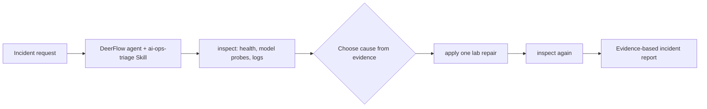

# DeerFlow AI Ops Agent Lab

A small, reproducible **AI application incident triage** project for [DeerFlow 2.0](https://github.com/bytedance/deer-flow). It adds a custom DeerFlow Skill with a real, deliberately broken HTTP application and a healthy model API stub. The agent observes the outage, picks a repair from evidence, and checks whether the application recovered.

This is a different problem from document Q&A or report generation: the deliverable is an incident diagnosis with a verified state change. It is a **local fault-injection lab**, not a production deployment or a real model server.

## What happens

| Incident | Symptom | Evidence to compare | Lab repair |
| --- | --- | --- | --- |
| `model_unreachable` | App `/health` returns 503 | Configured model URL fails; inventory model URL answers | `fix_model_url` |
| `wrong_model_id` | App `/health` returns 503 | Configured model URL answers, but its model list lacks the configured ID | `fix_model_id` |

The app and model stub bind to `127.0.0.1` on available ports. The app reloads `config.json` for each health check, so a repair has an observable effect without pretending to restart a production service. `ops_lab.py inspect` returns JSON with the app response, both model probes, configuration, inventory, and recent logs. `ops_lab.py apply` changes **only the marked lab directory** and records the action in `actions.jsonl`.



## Try the lab without DeerFlow

Requires Python 3.10+; no pip packages, cloud account, GPU, or Docker are needed for the lab itself.

From the repository root, use three terminals:

```bash
python skill/ai-ops-triage/scripts/ops_lab.py create --root ./demo-incident --case model_unreachable
```

```bash
python skill/ai-ops-triage/scripts/lab_service.py --root ./demo-incident
```

```bash
python skill/ai-ops-triage/scripts/ops_lab.py inspect --root ./demo-incident
python skill/ai-ops-triage/scripts/ops_lab.py apply --root ./demo-incident --action fix_model_url
python skill/ai-ops-triage/scripts/ops_lab.py inspect --root ./demo-incident
```

For the second case, create a **new empty** directory with `--case wrong_model_id` and use `--action fix_model_id`. The first inspection should show HTTP 503; the second should show HTTP 200. To rerun, choose a new directory name; `create` will not overwrite an existing incident.

Run the automated checks:

```bash
python -m unittest discover -s tests -v
```

## Use as a DeerFlow 2.0 Skill

Install DeerFlow 2.0 using its [official instructions](https://github.com/bytedance/deer-flow/blob/main/Install.md). Use its Docker-based AIO sandbox so the Bash tool is available; the default local sandbox disables host Bash. Copy this repository's `skill/ai-ops-triage` directory into the DeerFlow checkout at `skills/custom/ai-ops-triage`, then start DeerFlow. DeerFlow projects custom skills into its sandbox under `/mnt/skills/custom/`. Ask it:

> `/ai-ops-triage` Run the `wrong_model_id` incident. Diagnose it from the probes and logs, apply only the supported lab fix, and show the before/after health result.

The full agent workflow is in [`skill/ai-ops-triage/SKILL.md`](skill/ai-ops-triage/SKILL.md). It requires a fresh directory beneath `/mnt/user-data/workspace/ai-ops-lab` for each run. The local lab and tests run independently of DeerFlow; the DeerFlow integration still needs verification in a running DeerFlow sandbox.

## Scope and provenance

This repository contains the incident Skill, Python lab, and tests written for this project. DeerFlow supplies the agent runtime, tool execution, and Skill loading; its source is **not** vendored here. The model API is a stub that returns an OpenAI-compatible `/v1/models` response. The lab does not measure model quality, inference throughput, production reliability, or an actual vLLM deployment.

## License

MIT. See [LICENSE](LICENSE).
